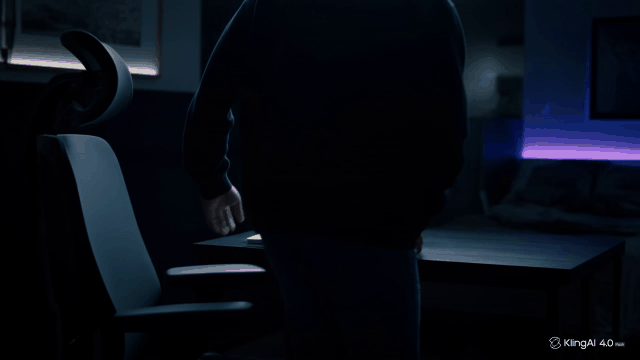
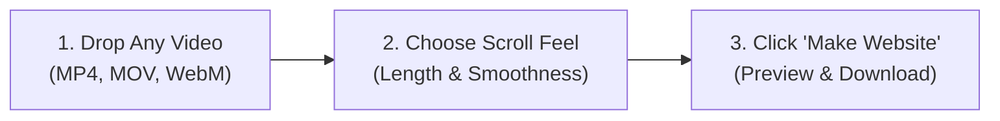

# 🎬 Scroll Video Maker

<div align="center">

[](https://github.com/Harish-Huded-29/video-scroll-animation-project/releases/tag/v1.0.0)
[](https://github.com/Harish-Huded-29/video-scroll-animation-project/releases/tag/v1.0.0)
[](https://www.python.org/)
[](LICENSE)

<br>

### **Turn any video into an interactive scroll animation — with zero coding!**

*Have you seen Apple's product pages where scrolling down smoothly animates a 3D product or video?*  
**Scroll Video Maker** turns your ordinary video file into that exact interactive web experience in seconds.

<br>

<a href="https://github.com/Harish-Huded-29/video-scroll-animation-project/releases/download/v1.0.0/ScrollVideoMaker.exe">
  
</a>

<br>
<sub>✨ Standalone application • No Python or installation needed • Ready to run</sub>

</div>

---

## 👀 See It In Action (Before & After)

See the difference between a standard video and the interactive scroll website generated by this tool:

| 🎥 Standard Video (Before) | 🌐 Interactive Scroll Website (After) |
| :---: | :---: |
| **Plays automatically at one fixed speed** | **You control the animation by scrolling!** |
| [](https://github.com/Harish-Huded-29/video-scroll-animation-project/blob/main/video-and-frames/video.mp4) | <br><br> 👇 **Scroll down** = Plays video forward<br> 👆 **Scroll up** = Plays video backward<br><br> ✨ Smooth physics inertia<br> 🖥️ Fullscreen toggle (**Esc** key)<br><br> |
| <a href="https://github.com/Harish-Huded-29/video-scroll-animation-project/blob/main/video-and-frames/video.mp4"></a> | <a href="https://htmlpreview.github.io/?https://github.com/Harish-Huded-29/video-scroll-animation-project/blob/main/video-and-frames/index.html" target="_blank"></a> |

> 💡 **Quick Local Test:** If you clone this repository, you can double-click [`video-and-frames/index.html`](video-and-frames/index.html) or [`demo.html`](demo.html) to play with the interactive scroll website directly in your browser offline!

---

## 💡 How It Works (In 3 Simple Steps)



1. **Drop your video:** Drag and drop your video into the app.
2. **Choose your scroll feel:** Pick how long people should scroll and how smooth you want the motion to feel.
3. **Preview & Export:** Scroll your website live in your browser, then download all frames and ready-to-use HTML code with 1 click!

---

## 🚀 How to Run It (Pick What Fits You)

### 🌟 Option 1: Standalone Application (`.exe`) — *No Python Needed!*
*Best for creators, designers, and anyone who wants an app that just works.*

1. **[Download ScrollVideoMaker.exe](https://github.com/Harish-Huded-29/video-scroll-animation-project/releases/download/v1.0.0/ScrollVideoMaker.exe)** (from our official [v1.0.0 Release](https://github.com/Harish-Huded-29/video-scroll-animation-project/releases/tag/v1.0.0)).
2. Double-click **`ScrollVideoMaker.exe`** to open it.
3. Your web browser will automatically open with the app ready to use. That's it!

> [!TIP]
> **Windows Security / SmartScreen Note:**  
> Because this is a free open-source project that doesn't use an expensive corporate certificate, Windows might show a blue prompt saying *"Windows protected your PC"*.  
> 👉 Click **"More info"** → Click **"Run anyway"**.  
> *(You can also right-click `ScrollVideoMaker.exe` → **Properties** → check **Unblock** at the bottom → click **OK**).*

---

### 🐍 Option 2: Run with Python (For Developers)
*If you already have Python installed and want to run it from your terminal.*

1. **Clone the repository:**
   ```bash
   git clone https://github.com/Harish-Huded-29/video-scroll-animation-project.git
   cd video-scroll-animation-project
   ```

2. **Install the two required libraries:**
   ```bash
   pip install opencv-python Pillow
   ```

3. **Start the application:**
   ```bash
   python scrollvideo.py
   ```
   The interactive interface will automatically open in your browser at `http://localhost:8000`.

---

## 🎛️ Settings Explained in Plain English

| Setting | What it means | Recommended Setting |
| :--- | :--- | :--- |
| **Scroll Length** | How much the visitor scrolls to complete the video.<br>• Low number (5–10): Fast scroll, video finishes quickly.<br>• High number (20–100+): Slower, more cinematic scroll story. | **20 screens** |
| **Smoothness** | How smooth the motion feels as someone spins their mouse wheel.<br>• **Light (Left):** Fewer frames, fastest page loading.<br>• **Ultra (Right):** Maximum frames, silky butter-smooth motion. | **Smooth (Center / 50%)** |
| **Resolution** | The size and crispness of each frame.<br>• **HD (720p):** Ultra-lightweight, great for mobile.<br>• **Full HD (1080p):** Crisp and clear on laptops and monitors.<br>• **2K / 4K:** Maximum detail for high-end displays. | **Full HD (1080p)** |
| **Image Format** | The file type for the extracted frames.<br>• **WebP:** Modern format, tiny file sizes, sharp quality.<br>• **JPG:** Universal compatibility with older devices.<br>• **PNG:** Lossless pixel perfection (largest file size).<br>• **AVIF:** Next-generation super compression. | **WebP** |
| **Video Fit** | How the video fits the visitor's screen.<br>• **Cover:** Fills 100% of the screen edge-to-edge (no black bars).<br>• **Contain:** Shows the complete uncropped video (adds letterbox bars if screen shape differs). | **Cover** |

---

## 🎁 What You Get When You Export

When you generate your scroll animation, you get:
1. **Interactive Preview:** Test scrolling live right in your browser with full-screen mode support (`Esc` key to exit).
2. **Download Frames Button:**
   - In modern browsers (Chrome/Edge), choose any folder on your computer and the app saves all extracted frames directly into a `frames/` subfolder.
   - Also supports **1-Click ZIP Download** to download all frames in a clean compressed archive.
3. **Ready-to-Host Code:** You can upload your generated `index.html` and `frames/` folder directly to GitHub Pages, Netlify, Vercel, or WordPress.
4. **Zero Memory Leak:** When you close the app or switch videos, all temporary RAM and disk caches are instantly cleaned up.

---

<details>
<summary><b>💻 Advanced: Terminal CLI Mode (For Power Users)</b></summary>

<br>

You can bypass the web interface and build a scroll animation directly from your terminal:

```bash
# Basic usage
python scrollvideo.py my_video.mp4

# Custom settings
python scrollvideo.py my_video.mp4 --screens 25 --smoothness 75 --width 1920 --format webp --fit cover
```

#### Available Flags:
- `--screens <number>`: Number of page heights to scroll (e.g. `20`)
- `--smoothness <1-100>`: Smoothness level from Light (`1`) to Ultra (`100`)
- `--width <px>`: Resolution width (`1280`, `1920`, `2560`, `3840`)
- `--format <format>`: Frame format (`webp`, `jpg`, `png`, `avif`)
- `--quality <40-100>`: Image compression quality (default `82`)
- `--fit <cover|contain>`: Sizing mode
- `--port <number>`: Local server port (default `8000`)
- `--no-browser`: Run headless without popping up your web browser

</details>

<details>
<summary><b>🛠️ How to Compile the .exe Yourself from Source</b></summary>

<br>

If you want to package the `.exe` yourself using PyInstaller:

```bash
pip install pyinstaller
python -m PyInstaller --noconfirm --clean --onefile --version-file version_info.txt --distpath app --workpath build --name "ScrollVideoMaker" --collect-all cv2 --collect-all PIL scrollvideo.py
```

The compiled standalone executable will be saved in `app/ScrollVideoMaker.exe`.

</details>

---

## 📂 Project Structure

```
video-scroll-animation-project/
├── app/
│   └── ScrollVideoMaker.exe    # Standalone windowed desktop app (No Python needed)
├── assets/
│   ├── icon.ico                # Multi-resolution application icon (Windows binary)
│   ├── icon.png                # High-res glowing 3D logo
│   └── favicon.ico             # In-app browser favicon
├── scrollvideo.py              # Complete Python app (server + extraction engine + UI)
├── demo.html                   # Offline interactive demo launcher
├── video-and-frames/
│   ├── video.mp4               # Sample source video
│   ├── video-preview.gif       # Animated demonstration preview
│   ├── index.html              # Standalone interactive scroll website
│   └── frames/                 # 265 extracted WebP animation frames
├── version_info.txt            # Windows binary metadata & manifest
├── requirements.txt            # Python dependencies (opencv-python, Pillow)
└── README.md                   # Documentation & creator guide
```

---

## 👤 Author & Support

Created with ❤️ by **[Harish Huded](https://github.com/Harish-Huded-29)**

If you found this tool useful for your projects or client websites, please consider giving it a **Star ⭐ on GitHub** — it helps a lot!
